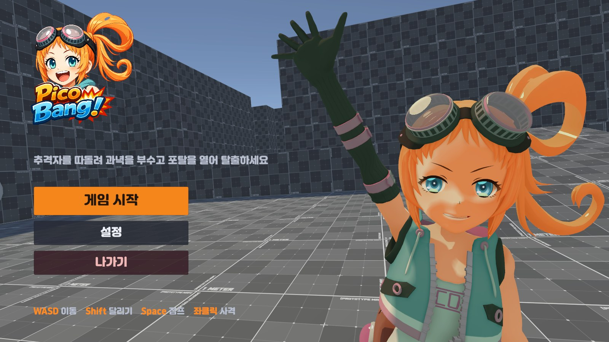

# Pico-Bang!

Unity 6로 만든 3인칭 추격 게임입니다.
추격자를 따돌려 과녁을 부수고 포탈을 열어 탈출합니다. 몬스터 다섯 마리가 뒤에서만 따라오지 않고 앞·옆길에서도 나타납니다.

**[플레이 빌드 받기](https://github.com/ChoKyungHwan98/Pico-Bang-/releases/latest)** · [영상](https://www.youtube.com/watch?v=WP-a5H4t384) · [기획서 (PDF)](https://chokyunghwan98.github.io/Portfolio/docs/pico-bang/pico-bang-design.pdf) · [포트폴리오](https://chokyunghwan98.github.io/Portfolio/)

## 플레이하기

1. [Releases](https://github.com/ChoKyungHwan98/Pico-Bang-/releases/latest)에서 `Pico-Bang_Win64.zip`을 받습니다.
2. 압축을 풀고 `Pico-Bang.exe`를 실행합니다.
3. **게임 시작**을 누릅니다. 끝낼 때는 시작 화면의 **나가기** 또는 `Alt + F4`를 누릅니다.

- Windows 10/11 64비트가 필요합니다.
- "Windows의 PC 보호" 창이 뜨면 **추가 정보 → 실행**을 누릅니다. 서명하지 않은 개인 빌드라서 뜨는 창입니다.
- 받는 파일은 약 94MB, 압축을 풀면 약 240MB입니다.

## 조작

| 키 | 동작 |
|---|---|
| `W` `A` `S` `D` | 이동 |
| `Shift` | 달리기 |
| `Space` | 점프 |
| 좌클릭 | 사격 |
| `F6` | 전술 지도 크게 보기 / 되돌리기 |
| `F7` | 지도 위 이름표 숨기기 / 보이기 |

## 게임 규칙

- 제한 시간 5분 안에 과녁 30개를 부수면 출구 포탈이 열립니다. 시작 지점으로 돌아가면 탈출입니다.
- 체력은 하트 5개입니다. 몬스터에 닿으면 하나씩 줄어듭니다.
- 과녁을 쏘면 부서지고, 몬스터를 쏘면 3초 동안 감전되어 멈춥니다. 감전된 몬스터는 몸을 통과할 수 있습니다.
- 총을 쏘면 소리가 납니다. 소리를 들은 몬스터는 소리 난 곳을 확인하러 옵니다.

## 화면의 추격 표시

몬스터가 어떻게 움직이는지 플레이 중에 볼 수 있게 했습니다.

- **오른쪽 아래, 전술 지도:** 몬스터 위치와 지나간 길을 보여 줍니다. 노랑은 플레이어, 빨강은 추격, 청록·보라는 우회(길목 막기), 파랑은 복귀, 초록은 순찰, 주황은 수색입니다.
- **판단 기록:** 감독 AI가 내린 최근 판단 다섯 줄이 지도 위에 잠깐 뜹니다. 예) "B: 발견 → 사냥 시작"
- **소리 표시:** 쏜 자리에서 소리가 퍼지는 원이 보이고, 들은 몬스터에는 "들음!"이 붙습니다.
- **오른쪽 위, 후방 화면:** 뒤에서 쫓아오는 몬스터를 볼 수 있습니다.

## 제작

- 기획 · 테스트: 조경환
- 구현: AI 도구 활용
- 캐릭터와 환경 등은 외부 에셋을 썼습니다. 에셋 원본은 이 저장소에 포함하지 않습니다.
